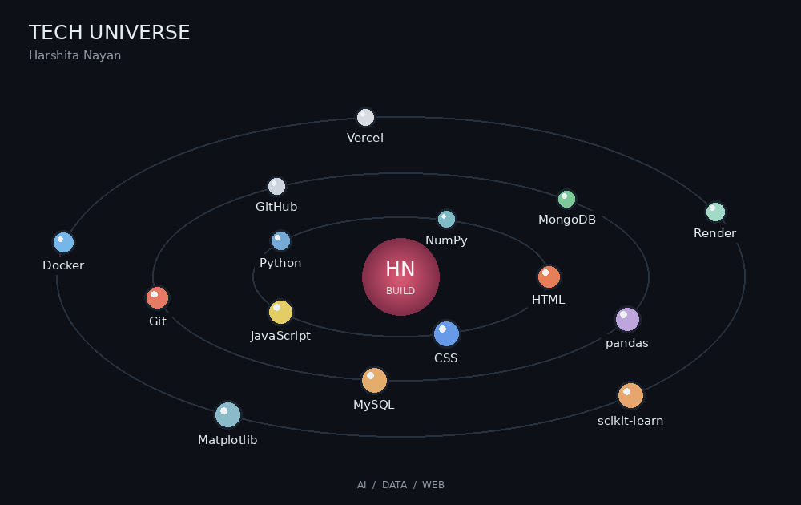

# Hi, I'm Harshita Nayan 👋

### Building useful ideas with AI and code.

I build AI-powered applications for learning, interview practice, and practical problem-solving. I enjoy turning an idea into an interactive experience and exploring how intelligent tools can make everyday tasks easier.

**Interests:** Artificial Intelligence · Machine Learning · Web Development

 

---

## Tech Stack

  

## Projects

|Pinned Projects | What it does | Highlights | Repository |
| --- | --- | --- | --- |
| **Hynex** | Invoqe AI chatbot — an AI learning assistant. | Conversational learning · AI assistance | [View code](https://github.com/HarshitaNayan/Invoqe_AIChatbot) |
| **Panopticon AI** | Browser-based AI exam proctoring with gaze, lip movement, phone, and tab-switch monitoring. | In-browser processing · Session PDF reports | [View code](https://github.com/HarshitaNayan/Panopticon-AI) |
| **SkillForge** | A hackathon platform connecting skill-based team formation with evidence-backed submissions and auditable judging. | Team formation · Claims and evidence · Normalized rankings | [View code](https://github.com/HarshitaNayan/SkillForge) |
| **InterVue AI** | An adaptive AI simulator for practicing technical interviews. | Voice interviews · Adaptive follow-ups · Resume personalization · Performance reports | [View code](https://github.com/HarshitaNayan/Intervue-AI) |

## GitHub Activity

  
  

### Contribution Streak

  

### Connect

